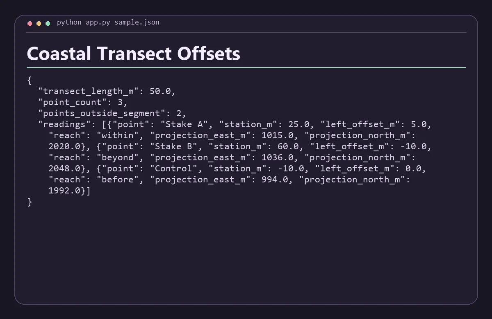

# Coastal Transect Offsets

Project local survey observations onto a straight coastal transect to measure distance along the line and signed cross-track offsets.



## Run

Install Python 3.11 or newer. Run these commands from the repository root.

```sh
python app.py sample.json
```

Replace `sample.json` with a JSON file following the same structure. The app prints a JSON report to standard output.

Enter survey control and observations in one local planar coordinate system, in meters. Station zero is the start. Positive offsets are to the left while looking from start toward end. Stations outside the measured segment are reported as before or beyond, with classifications at millimeter precision. Projections are on the extended line.

## Verify

Run `python check.py` with Python 3.11 or newer after the build step when applicable. The check verifies the bundled scenario and confirms that an invalid input returns an error.
